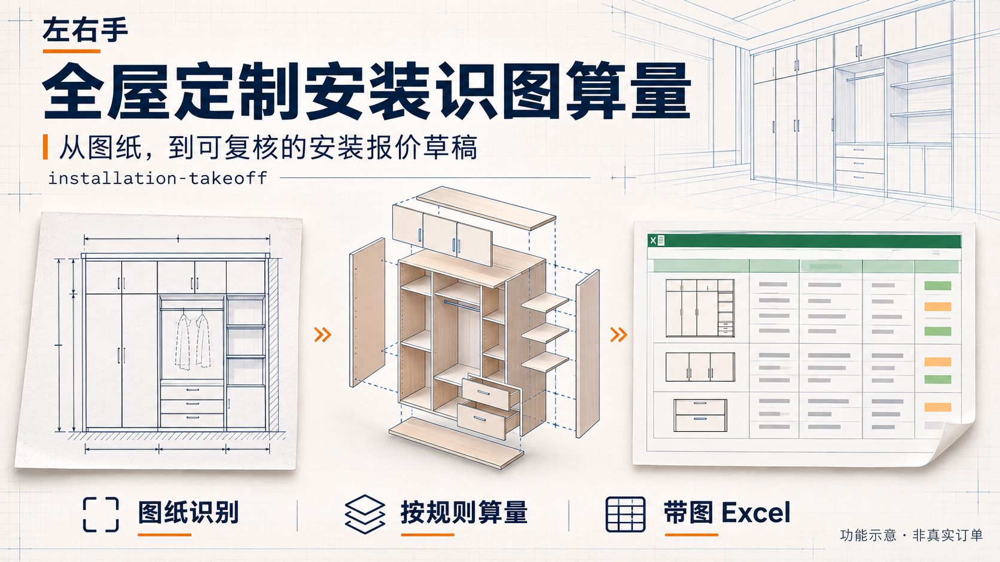
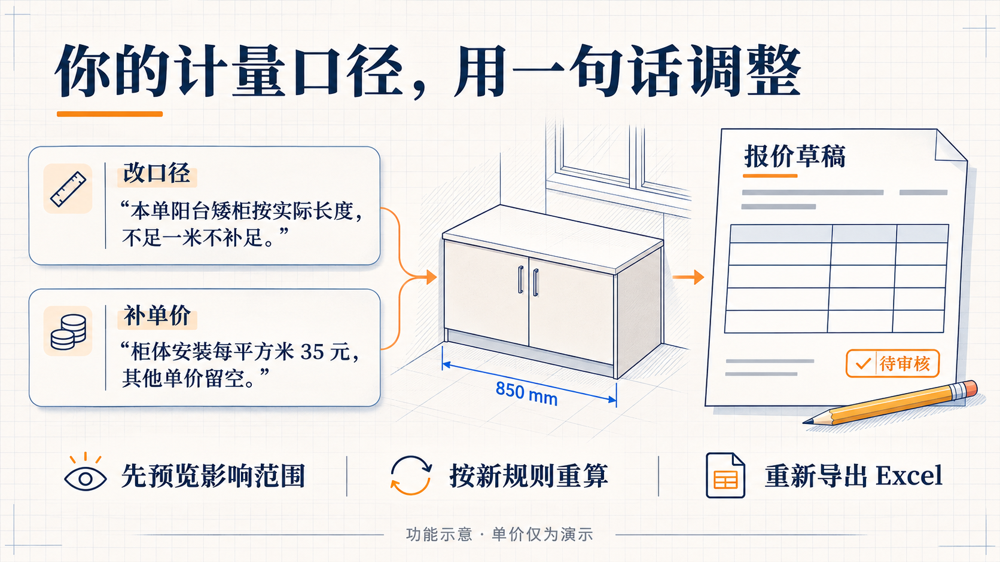
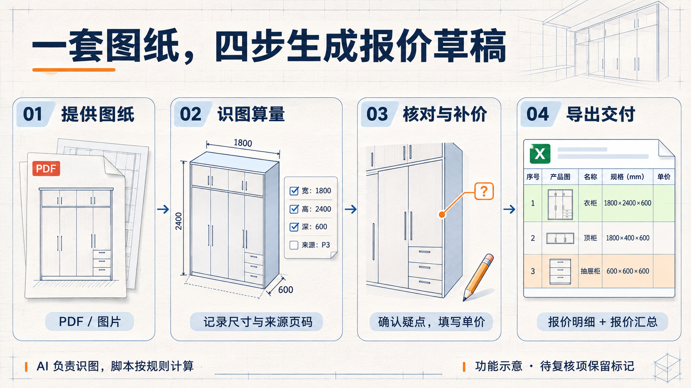

# 左右手 · 全屋定制安装识图算量

> 最后更新：2026-11-05 · 技能版本：v1.4.3



把 PDF / 图片图纸交给 WorkBuddy，按计量规则生成工程量和带产品缩略图、来源页码的 Excel 安装报价草稿。单价可以口述补充，也可以在表格中填写。CAD 图纸需先按技能说明在本地转换。

## 安装：复制一句话


打开 **WorkBuddy**，把下面整句话复制过去发送即可：

```text
请安装这个地址的技能：https://github.com/HongFengFang1991/zuoyoushou-installation-takeoff
```

按智能体提示选择一个本地工作文件夹；若系统要求授权，只授权本次需要的目录和操作。安装、依赖检查和示例验证由智能体按说明执行，缺少环境时由它说明下一步。完整安装规则见 [INSTALL.md](INSTALL.md)。

安装成功与识图验证成功分别报告；先用随包示例确认可用，再提交真实图纸。

## 模型怎么选


在 WorkBuddy 中，优先选择**明确标有“图片输入”**的模型版本。Kimi-K3、Hy4 preview 可以作为试用起点；这是根据客户端能力说明给出的候选建议，尚无本技能的准确率或耗时排名。可用型号以实际账户和客户端为准。[WorkBuddy 官方模型说明](https://www.codebuddy.cn/docs/workbuddy/From-Beginner-to-Expert-Guide/Function-Description/Model)

DeepSeek V4.1 Flash 可在确认当前宿主能实际传入图片后试用。DeepSeek 官方 API 支持图片，并不代表 WorkBuddy 所有内置同名或近似名称的路由也开放了图片能力；先打开一张带尺寸线的示例图，确认能指出尺寸及对应位置。[DeepSeek 官方视觉说明](https://api-docs.deepseek.com/guides/vision/)

模型需要能看图、辨认尺寸与产品结构、按指令调用工具；智能体环境需要能查看本地图片、读写本单文件、执行 Python 3.11+。思考强度从客户端默认档位开始；看不清或有冲突时保留疑点，由人工核对。

## 装好后怎么用


上传 PDF / 图片后，直接发送：

```text
帮我算这套图纸的安装工程量，按默认规则，单价先留空，导出带产品缩略图和来源页码的 Excel，有疑点请带我核对。
```

默认每批处理 3–4 页，逐批保存进度。交付后检查产品图、来源页码与待复核项，再补充价格。保留整个本单项目目录，方便继续改价、改规则和重导出。

## 改口径、补价格，都可以直接说



修改本单规则：

```text
本单阳台矮柜按实际长度，不足一米不补足。先告诉我影响哪些行，再按这个口径重算。
```

补充价格：

```text
柜体安装每平方米 35 元，厨房吊柜每米 45 元，其他单价留空，重新导出 Excel。
```

图中单价仅为演示。修改规则和补价时，优先基于已保存的尺寸重算；需要新尺寸时只复查相关图纸。

## 豆包可以用吗


豆包开放平台提供 Skill 接入机制；本仓库技能在**豆包工作模式**的安装、脚本运行和完整导出仍需验证，暂不作为已适配承诺。是否能从 GitHub 安装外部技能、执行脚本和交付文件，以用户实际版本与权限为准。[豆包官方 Skill 接入指南](https://open.doubao.com/document/doubao-developer-guide/skill-integration-guide)

需要试用时，先把下面的话发给豆包工作模式：

```text
请先检查能否运行 https://github.com/HongFengFang1991/zuoyoushou-installation-takeoff 的安装算量技能，包括读取完整技能、查看图片、执行 Python 和导出带图 Excel，明确告诉我可用项和缺少的能力，暂不处理客户图纸。
```

## 输出与复核

Excel 包含「报价明细」「报价汇总」两个页签，保留产品局部图、来源页码、状态、公式和合计。绿色表示证据检查通过，橙色表示待复核；仍需人工核对。缺价留空，免费项目才填 0。具备必要输入的待复核项按技能规则暂计，缺必要尺寸时保留行并说明原因。

模型负责识图，脚本按规则计算；不同模型识图输入可能不同，不能保证跨模型结果一致。脚本不直接调用模型 API，视觉请求的数据处理方式由宿主决定。客户图纸、报价工程目录、日志和私有价格档案不要提交到公开仓库。

<details>
<summary>展开查看完整工作流程</summary>



</details>

## 仓库文件

- `skills/installation-takeoff/`：完整技能、脚本、参考资料、模板与合成示例。
- `INSTALL.md`：智能体安装与验证说明。
- `release-manifest.json`：技能文件清单与校验值。
- `docs/images/`：README 功能示意图和应用图标。示意图不代表真实订单或实际软件截图。

